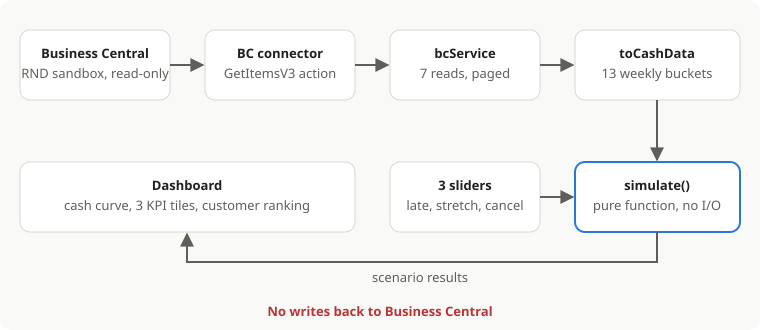
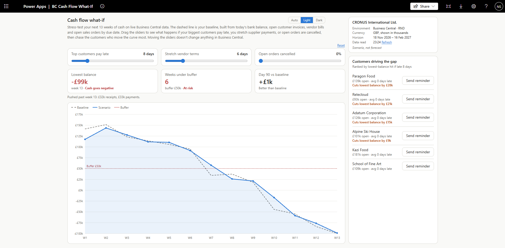

Every finance lead eventually asks the same thing: **"If our biggest customers pay late, when do we run out of room?"**

Business Central already forecasts cash well (the Cash Flow Forecast, plus optional AI). But testing a scenario there means changing setup or entries and recalculating. That is fine for planning. It is slow for a conversation in a meeting.

So I built the other half: a **scenario tool, not a forecast**. Three sliders, one curve, instant answers.

## The business case

- **Customers pay late:** your top customers slip by 0 to N days.
- **Vendor terms stretched:** you pay suppliers N days later.
- **Open orders cancelled:** a share of open sales orders never arrives.

Three tiles answer the meeting question: **lowest balance**, **weeks under your safety buffer**, and **day 90 vs baseline**. A side panel ranks the customers who move the curve most, so you know who to call first.

Nothing is written back to Business Central. Moving a slider changes nothing in the ledger.

In my sandbox, pushing the top customers to 30 days late turned [X] weeks red and dropped the lowest balance to [-£XXk]. Stretching suppliers by 14 days pulled it back above the buffer. That is the whole pitch, in ten seconds.

## The data flow




Seven reads on load, one pure function in the middle, zero writes:

| Read | Table (BC API) | Used for |
|---|---|---|
| Starting cash | `balanceSheets` ("Cash" line) | Week 0 balance |
| Customers | `customers` | Names, ranking |
| Open receivables | `customerLedgerEntries` + detailed entries | Cash in, by due date |
| Open payables | `vendorLedgerEntries` + detailed entries | Cash out, by due date |
| Open orders | `salesOrders` | Future cash in |
| Payment terms | `paymentTerms` | Order date to cash date |
| Company name | `GetCompaniesV3` | The label on screen |

## How to build it

### 1. Use a code app and call the connector action

A Power Apps **code app** is a normal React + Vite + TypeScript app that runs inside Power Platform with your connections and your sign-in. Add the BC connector as an *action* source:

```powershell
pa app add data-source --connector shared_dynamicssmbsaas `
  --connection-ref <your-connection-reference> --as action --non-interactive
```

### 2. The 404 that cost me an afternoon

The generated table services looked perfect. Every read returned **404 "Resource not found"**. The connection was fine. The URL was the problem: generated services build a generic `/datasets/.../tables/.../items` route that the BC v3 connector does not serve.

The fix: skip the table service and call the connector's `GetItemsV3` action.

```ts
// Simplified: one page of up to 1000 rows from any BC API table.
const res = await Dynamics365BusinessCentralService.GetItemsV3(
  'RND',            // BC environment name
  companyGuid,      // company id
  'v2.0',           // dataset
  'customers',      // table
  undefined, filter, undefined, 1000,
)
```

Second trap: the analytics dataset (`microsoft/analytics/v1.0`, where the ledger entries live) must be **URL-encoded** when you pass it, or you get another 404.

```ts
const ANALYTICS = encodeURIComponent('microsoft/analytics/v1.0')
```

### 3. Turn ledger entries into open items

A customer ledger entry is not the amount still owed. Sum its **detailed ledger entries** per open entry to get what is actually outstanding. Overdue items land in week 1, and anything past week 13 is dropped. An open sales order lands at **delivery date plus payment terms**.

### 4. Bucket by week, then keep the maths pure

```ts
// Everything becomes arrays of 13 weekly numbers (in thousands).
type CashData = { opening: number; receipts: number[]; payments: number[] /* ... */ }

function simulate(data: CashData, lever: Levers) {
  const receipts = shiftSeries(data.receipts, lever.customerLateDays)
  const payments = shiftSeries(data.payments, -lever.vendorStretchDays)
  return cumulative(data.opening, receipts, payments)
}
```

A slider is just a **shift of a series**. There is no server call, so the curve redraws as you drag. Because `simulate` is a pure function, it is easy to test: 19 unit tests pass.

### 5. Draw the chart yourself

A small SVG chart that measures its container with a `ResizeObserver` and picks round tick steps. No chart library, one component, and it fills the screen without scrolling.

## What I would tell you before you copy it

- **Be honest in the UI.** It says "Scenario, not forecast". The 60% "movable" share of outflows and the top-3 late customers are my assumptions, not BC data.
- **Read-only first.** Reads cost nothing and prove the value. Writing a reminder back is a separate decision (I would use its own Dataverse table, never ledger entries).
- **Demo data.** This ran on a CRONUS sandbox. No real company has used it yet.

## Try it on your own data

1. Start a code app and add the BC connector as an action source.
2. Read cash, open receivables, open payables and open orders with `GetItemsV3`.
3. Bucket into 13 weeks and write one pure `simulate()`.
4. Add three sliders.

An afternoon, if you skip my 404 detour.

