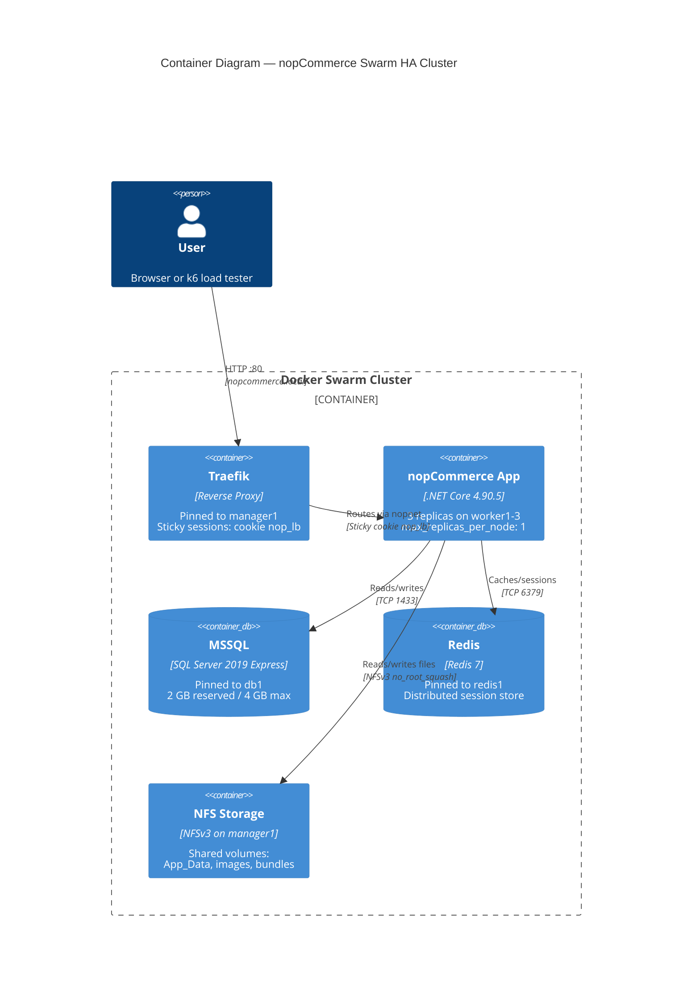
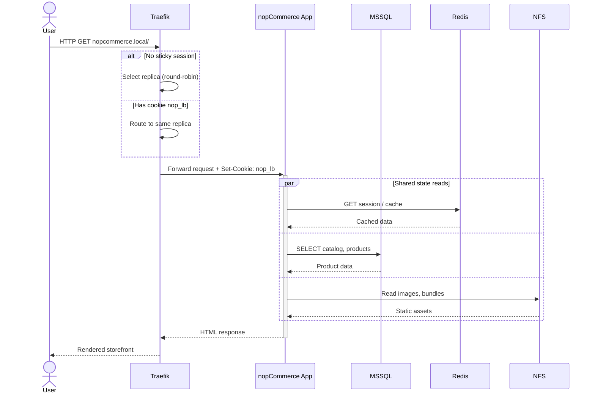
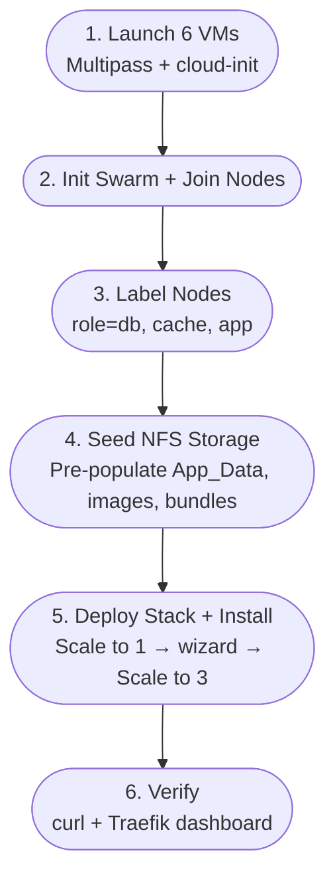

## I Clustered a .NET Monolith Across Docker Swarm Because Nobody Else Had Written It Down

## The problem nobody wanted to talk about

I wanted to answer a question that sounds simple until you actually try it: can you take nopCommerce, a stateful .NET Core monolith that was never designed with horizontal scaling in mind, and run it across multiple nodes in a real high-availability topology?

Not "run it in a container." Every getting-started guide has that covered in ten minutes. I mean run three replicas of the app behind a load balancer, on three different machines, with a shared database, a shared cache, and shared file storage, and have it survive an install wizard, session state, and file writes without falling over.

I searched. I found Docker Compose tutorials that spin up nopCommerce and MSSQL on a single host and call it a day. I found Kubernetes Helm charts for other e-commerce platforms that don't map cleanly onto nopCommerce's architecture. I found nothing that walked through the specific failure modes you hit when you try to scale nopCommerce horizontally on Swarm. So I built a six-VM cluster on my own machine and worked through every failure myself, one at a time, until it worked. This is that process, written up the way I wish someone had written it up for me.

## Why this mattered beyond "because I could"

There's a real business case buried under the lab-project framing. A lot of mid-market retailers run nopCommerce because it's mature, .NET-based, and cheaper to license and staff than the big SaaS platforms. But almost all of them run it as a single instance. Single instance means single point of failure, no rolling deploys without downtime, and no horizontal capacity for traffic spikes like a flash sale. If you're the engineer who has to tell your boss "we can't do zero-downtime deploys and we can't survive a node failure," that's not a great position to be in.

The pitch I was validating was: can a small team, without a Kubernetes budget or a Kubernetes-sized ops headcount, get nopCommerce into an HA posture using tools they probably already half-know? Docker Swarm is built into the Docker Engine. No separate control plane to run, no CRDs to learn, no six-week ramp-up. If Swarm could get nopCommerce to survive a node loss and scale horizontally, that's a genuinely useful result for a lot of teams that will never justify a Kubernetes migration.

## The environment

I built this entirely on my own Windows machine using Canonical Multipass to provision six Ubuntu VMs, no cloud spend, no shared infrastructure to argue about:

| VM | Role |
|---|---|
| `manager1` | Swarm manager, Traefik reverse proxy, NFS server |
| `db1` | SQL Server 2019 Express |
| `redis1` | Redis 7, distributed cache/session store |
| `worker1-3` | nopCommerce app, one replica each |

Six nodes, cloud-init YAML for provisioning, a Docker Swarm stack file for the actual deployment. On paper this looks like a normal three-tier app. In practice, every one of the "obvious" pieces broke in a non-obvious way, and I want to walk through them in the order I actually hit them, because the order matters for understanding why each fix looked the way it did.

## Failure #1: the app writes files, and Swarm doesn't care where your worker is

nopCommerce isn't stateless. It writes to `App_Data` for settings and plugin state, and to `wwwroot/images` and `wwwroot/bundles` for uploaded product images and compiled CSS/JS. On a single host that's just a folder. Across three worker nodes, each replica has its own local filesystem, so a product image uploaded through the replica on `worker2` doesn't exist on `worker1` or `worker3`. That's not a cosmetic bug, it's data loss dressed up as a 404.

The fix is the obvious one on paper: shared storage. I stood up an NFS server on `manager1` and exported three directories, then mounted them as Docker volumes on all three app replicas. This is where "obvious" and "worked on the first try" stopped being the same thing.

## Failure #2: NFSv4 silently breaks root writes, and it will not tell you why

I started with NFSv4 because it's the modern default and every guide points you there. The mount succeeded. The export looked correct. And nopCommerce's installer still failed to write to `App_Data`, with permission errors that made no sense given the export was configured `no_root_squash`.

The root cause took me a long time to isolate: NFSv4 has an idmap layer that remaps UIDs between client and server based on name-to-ID mapping, and that remapping happens regardless of `no_root_squash`, because `no_root_squash` only controls squashing, not idmapping. Containers write as root or as non-standard UIDs that don't have a clean identity mapping on the NFS server, so the idmap layer quietly remaps them into something that doesn't have write permission, and you get permission denied errors that look like a `no_root_squash` misconfiguration but aren't.

The fix was to force `nfsvers=3` on the mount. NFSv3 doesn't have the idmap layer at all, so the UID goes over the wire as-is and `no_root_squash` behaves the way the name suggests it should. This was the single most impactful discovery in the whole project. Every other storage problem downstream traced back to this one line in the mount options.

## Failure #3: empty volumes shadow the files that were already there

Once the NFS mounts were working, the app still crashed on startup with `DirectoryNotFoundException`. The reason is easy to miss if you haven't hit it before: the nopCommerce image ships with `App_Data`, `images`, and `bundles` already populated with default files. The moment you mount an empty NFS-backed volume over those paths, Docker doesn't merge the contents, it shadows them. The container now sees an empty directory where it expects populated defaults, and the app fails at boot before it ever gets a chance to write anything itself.

The fix was to seed the NFS export before deploying the stack: run the nopCommerce image once with a bind mount pointed at the NFS path, and copy the built-in `App_Data`, `images`, and `bundles` contents out of the image and into the export. Only after that seed step does the real stack deployment have a populated filesystem to mount. Skip this step and every replica fails identically, which at first looks like a networking problem and is actually a files-that-were-never-there problem.

## Failure #4: the install wizard doesn't know it's talking to three different processes

With storage sorted, I deployed the stack behind Traefik and hit the install wizard, and got redirect loops. Not consistent failures, just loops that happened often enough to be unusable.

nopCommerce's multi-step installer keeps intermediate state (antiforgery tokens, `TempData`) in server memory during the install flow. With three replicas behind a round-robin load balancer, each request in the install sequence could land on a different replica that has no idea the previous step ever happened. The install wizard was never written with the assumption that "the server" might be three different processes.

Two changes fixed this. First, Traefik sticky sessions via a cookie (`nop_lb`), so once a client gets routed to a replica, every subsequent request from that client goes to the same one. Second, and this turned out to matter even with sticky sessions in place: scale the app service down to a single replica before running the installer, complete the wizard, then scale back up to three. Sticky sessions handle steady-state traffic fine, but the install flow has enough shared-but-not-synchronized intermediate state that running it against multiple replicas at all is asking for trouble. Scale to one, install, scale back out. It's a two-line `docker service scale` workaround for a problem that would otherwise cost you a redesign of the installer.

## Failure #5: sessions and cache still need to survive a replica dying

Sticky sessions solve routing, not durability. If a worker node goes down, its replica goes with it, and any session state that only existed in that replica's memory goes down too. That defeats the entire point of running multiple replicas.

I put Redis 7 in front of nopCommerce as its distributed cache and session backend, pinned to its own node. Once session state lives in Redis instead of in-process memory, a replica dying is a routing problem Traefik can recover from, not a data-loss event for the user mid-session.

## What the final architecture actually looks like

By the time everything was wired together, the request path for a single page load was: Traefik terminates the request and either round-robins to a replica or routes by the sticky cookie, the app replica reads and writes session/cache state from Redis, pulls catalog and product data from MSSQL, and reads static assets from the NFS-backed volumes. Three independent shared-state systems, one request.

That diagram is the end state. What it doesn't show is the request-level choreography that has to happen for a single page load to succeed once sticky sessions, Redis, and NFS are all in play at once:

Three independent shared-state systems, one request, and every one of them had to be solved before this sequence would complete without an error.

Deploying it end to end follows the same order I hit the failures in, which is not a coincidence, each stage exists because skipping it breaks the next one:

## What I'd tell someone about to attempt this

If you're evaluating Swarm over Kubernetes for a workload like this, the case for Swarm holds up: no separate control plane, stack files are close enough to Compose that the learning curve is shallow, and built-in overlay networking plus placement constraints got me everything I needed for a 6-node topology. I wouldn't reach for Swarm at a much larger scale, but for a team that wants HA without a Kubernetes commitment, it's a legitimate answer, not just a stepping stone.

The honest caveats, because this was a staging-grade lab build, not a production sign-off: single Swarm manager and single Traefik instance mean the control plane and edge are not themselves HA, MSSQL and Redis are single instances with no replication or Sentinel/Cluster, the NFS server on `manager1` is a single point of failure for all shared storage, passwords are hardcoded in the stack file with Docker Secrets and real CI/CD still to be added, and it's HTTP-only pending Let's Encrypt. None of these are hard problems, they're just the next iteration, and I'd rather list them plainly than pretend a lab cluster is a finished production system.

The thing I keep coming back to is the NFSv3-over-NFSv4 fix. It's one mount option, and it was the difference between a cluster that looked correctly configured and silently failed, and one that actually worked. Nothing about that is discoverable from the nopCommerce docs or the Docker docs individually, because it lives in the gap between them. That's usually where the real R&D is: not in the parts anyone wrote a guide for, but in the seam between two systems that were never tested together.

## Further reading

- [Docker Swarm admin guide — manager quorum and Raft consensus](https://docs.docker.com/engine/swarm/admin_guide/) — the official basis for why a single-manager Swarm, like the one in this build, has no HA control plane, and what it takes to fix that.
- [nopSolutions/nopCommerce GitHub issue #2494 — full web farm support](https://github.com/nopSolutions/nopCommerce/issues/2494) — the open tracked discussion on nopCommerce's session/TempData behavior across multiple instances, including the cookie-based TempData alternative to sticky sessions.
- [nopCommerce community forum — running 4.5.x under a load balancer without sticky sessions](https://www.nopcommerce.com/en/boards/topic/95771/run-nopcommerce-45x-under-load-balancer-without-sticky-session-and-auto-scaling-enable) — a real-world report of the same class of failure this post describes hitting during the install wizard.
